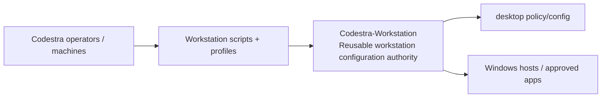
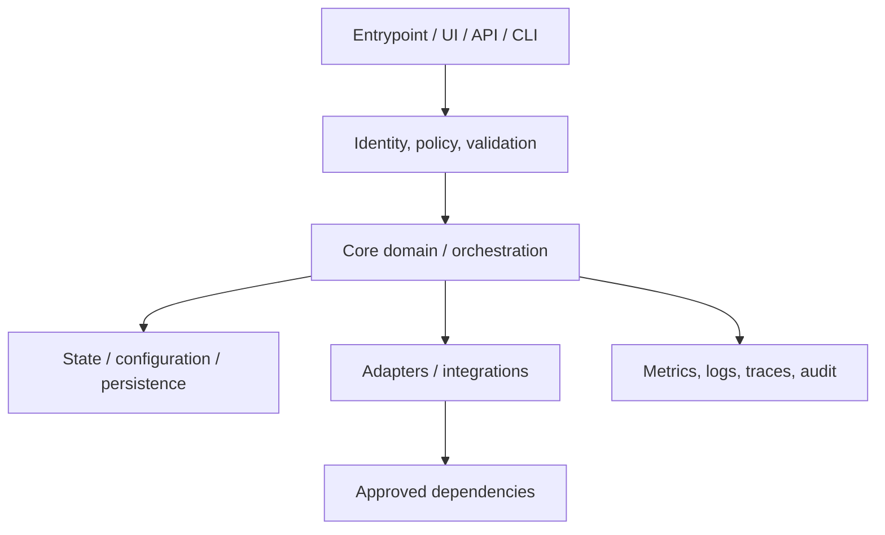
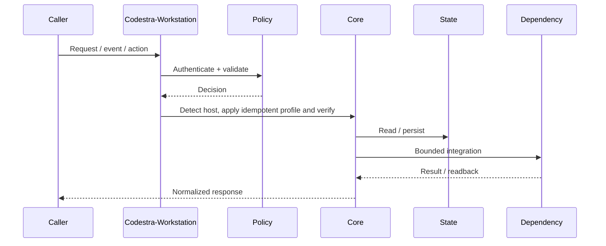
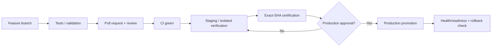
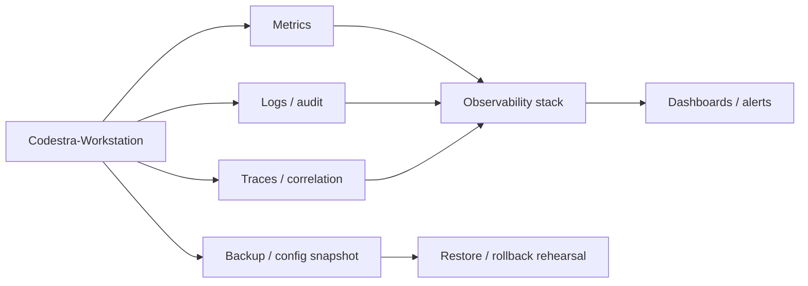

# Codestra-Workstation — Architecture Charts

> Repository: `appolon1908/Codestra-Workstation`
> Baseline branch: `feat/windows-professional-workstation-20260926`
> Repository-local visual architecture. Update these diagrams when implementation or authority changes.

## 1. System context

## 2. Internal component architecture

## 3. Critical flow

## 4. Deployment and promotion

## 5. Observability and recovery

## Ownership notes
- **Role:** Reusable workstation configuration authority
- **Primary boundary:** Workstation scripts + profiles
- **State/config:** desktop policy/config
- **Dependencies/consumers:** Windows hosts / approved apps
- Cross-repository effects must use reviewed contracts; production effects remain separately gated.
